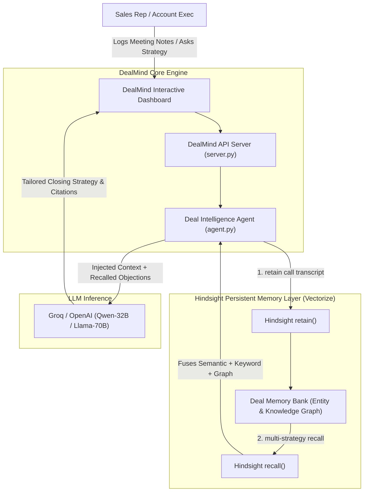

# 🎯 DealMind — Autonomous B2B Deal Intelligence Copilot
> **AI Agents That Learn Over Time Using [Hindsight Persistent Memory](https://github.com/vectorize-io/hindsight)**

[](https://hindsight.vectorize.io)
[](https://www.python.org/)
[](LICENSE)

---

## 📌 The Problem
In enterprise B2B sales cycles ($20k–$200k ACV), closing a deal takes 3 to 9 months and spans 8–15 meetings across diverse stakeholders: CFOs, Lead Architects, CISOs, and Procurement directors.

Sales reps constantly struggle with fragmented context:
* An objection voiced in Call 1 (e.g., *a board-mandated budget freeze until Q4*) is forgotten by Call 4.
* A competitor quote revealed in Call 2 (e.g., *CloudX quoting $15k with free migration*) is ignored when preparing executive pricing.
* A technical constraint (e.g., *refusal of closed-source vendor lock-in*) is violated by a generic sales deck.

**Stateless AI assistants fail here.** When a sales rep asks: *"Prepare my executive closing pitch for Monday"*, a stateless LLM produces a generic, tone-deaf response: *"Offer a 15% discount for annual upfront payment"* — a proposal guaranteed to trigger the CFO's budget veto.

---

## 💡 The Solution: DealMind
**DealMind** transforms sales agents from forgetful chatbots into continuous strategic deal partners. By anchoring the agent to **Hindsight persistent memory**, DealMind:
1. **Retains** every objection, competitor move, stakeholder role, and technical constraint across calls.
2. **Links** entities and temporal events into an evolving **Interactive Deal Knowledge Graph**.
3. **Ingests Documents & Transcripts** (.txt, .md, .json, .csv) with automatic entity extraction.
4. **Recalls** multi-call context on demand to generate lethal, objection-proof closing strategies.
5. **Separates Workspaces** with multi-tenant individual user authentication and session management.
6. **Automates Evaluation** with a 60-Second Demo Walkthrough tour for rapid judging.

---

## 🏗️ System Architecture



---

## ⚡ The Live Demo Showstopper: Before vs. After Memory

| Scenario | Standard Stateless AI (Without Memory) | DealMind (With Hindsight Memory) |
| :--- | :--- | :--- |
| **Call 1 (Discovery)** | Pitch generic features. | Retains Sarah's (CFO) strict **Q4 budget freeze**. |
| **Call 2 (Tech Review)** | Suggest standard cloud SaaS. | Retains Dave's (Architect) concern on **vendor lock-in** & **CloudX's $15k competitor quote**. |
| **Call 3 (Closing Pitch)** | ❌ *"Offer a 15% discount for an upfront annual contract."* <br>*(Vetoed by CFO immediately!)* | ✅ **Precision Closing Strategy**: <br>1. Proposes **deferred billing starting in Q4** (respecting Sarah's constraint).<br>2. Reassures Dave with **Docker/K8s export & open APIs** (neutralizing lock-in fear).<br>3. Directly counters **CloudX's hidden fees on Postgres migration** (neutralizing competitor). |

---

## 🧠 How Hindsight Memory is Integrated

DealMind leverages Hindsight's 3-phase memory lifecycle:

### 1. Retain (`memory_engine.py`)
```python
from hindsight_client import Hindsight

client = Hindsight(base_url="https://api.hindsight.vectorize.io", api_key=API_KEY)

# Retain meeting transcript with structured metadata
client.retain(
    bank_id="apex-logistics",
    content="[Discovery Call] Sarah (CFO) has an ironclad budget freeze until Q4. Upfront annual deals are forbidden.",
    metadata={"deal_id": "apex-logistics", "call_type": "Discovery", "tags": ["objection:budget", "stakeholder:cfo"]}
)
```

### 2. Recall (`agent.py`)
```python
# Multi-strategy search across semantic similarity, keywords, and knowledge graph
recalled_memories = client.recall(
    bank_id="apex-logistics",
    query="Objections, competitors, budget constraints, and pricing terms"
)
```

### 3. Reflect & Adapt
The agent fuses the recalled memories directly into prompt context, ensuring every pitch is backed by concrete historical citations.

---

## 🚀 Quickstart Guide (Zero-Dependencies)

### Step 1: Clone the Repository
```bash
git clone https://github.com/your-username/dealmind.git
cd dealmind
```

### Step 2: Configure Environment (Optional)
Copy `.env.example` to `.env` if you have a Hindsight Cloud or Groq API key:
```bash
cp .env.example .env
```
*(DealMind comes with pre-seeded demo memory banks and automatic fallback, so it runs immediately even without API keys!)*

### Step 3: Run DealMind
```bash
python3 server.py
# or: bash run.sh
```

Open your browser to:
👉 **`http://localhost:8080`**

---

## 📊 Judging Criteria Alignment

* **Innovation (30%):** Moves beyond generic chatbots to continuous deal-lifecycle intelligence.
* **Hindsight Memory (25%):** Memory is the sole reason the system functions — without it, the advice is disastrously generic.
* **Technical Implementation (20%):** Clean architecture, resilient offline caching fallback, and REST API integration.
* **User Experience (15%):** Responsive dark-mode dashboard with side-by-side battle screen and live memory timeline.
* **Real-world Impact (10%):** Directly saves B2B enterprise sales teams hundreds of hours and prevents lost multi-thousand dollar deals.

---

## 🔗 Official References
* [Hindsight GitHub Repository](https://github.com/vectorize-io/hindsight)
* [Hindsight Documentation](https://hindsight.vectorize.io/)
* [Vectorize Agent Memory Guide](https://vectorize.io/what-is-agent-memory)
